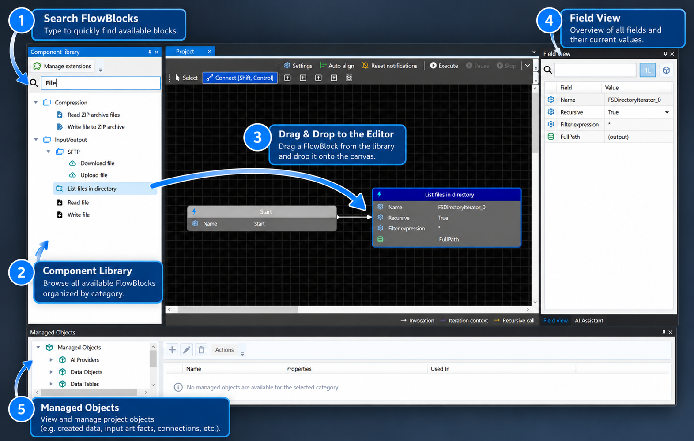
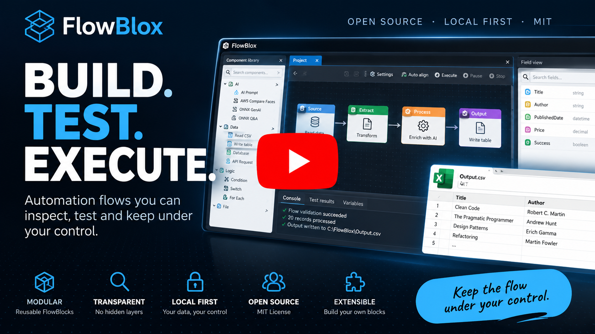
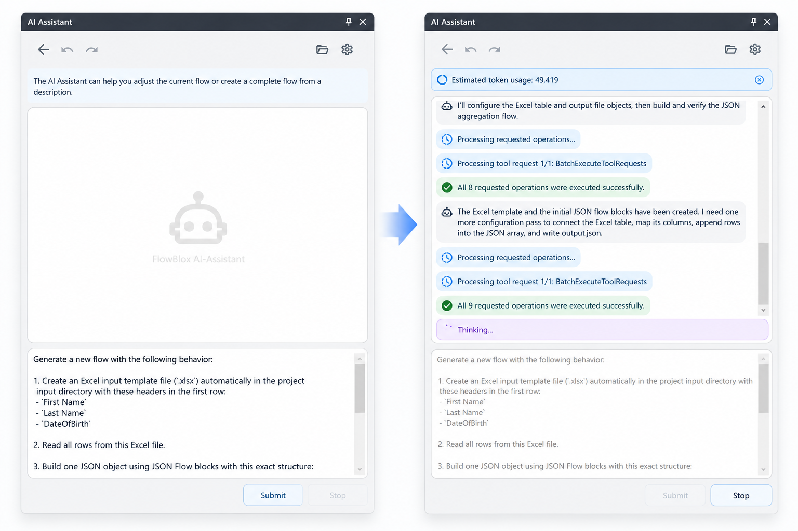
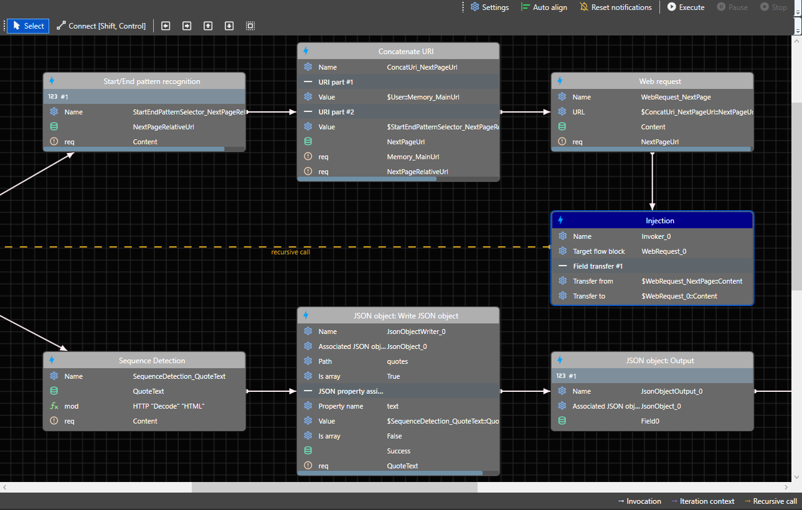

# FlowBlox

### AI Builds It. You Own It.

**Open-source, local-first visual automation — with AI-generated workflows you can inspect, edit, test, and run yourself.**

FlowBlox turns real-world data-processing problems into reusable automation projects. Build workflows visually from existing FlowBlocks, or describe your task to the integrated AI Assistant and let it create or extend a **fully editable FlowBlox project**. Run locally without setting up a server, and automate execution through the desktop application, CLI, operating-system task scheduler, or a service.

**Windows x64 · MIT licensed · .NET-based · Local-first**

[**Get started**](#quick-start) · [**Watch overview**](#video-overview) · [**See examples**](#example-projects) · [**Contribute**](#contributing)

## Video overview

<!-- TODO: Replace VIDEO_ID with the published FlowBlox overview video ID and add its thumbnail at docs/images/youtube-overview.png. -->

## Why FlowBlox?

- **Start locally, without infrastructure.** Install the Windows desktop application and build workflows without provisioning a server or Docker environment. Connections to external systems and cloud AI providers still require their respective credentials or services.
- **AI-generated, human-editable workflows.** The AI Assistant can create new projects, continue existing ones, configure FlowBlocks, test results, and explain the application. Its output remains a regular visual project, not an opaque one-off agent action.
- **AI that can build reusable tools.** The assistant can use existing Auxiliary Projects as skills and assemble new auxiliary flows from available FlowBlocks when it needs additional capabilities.
- **Work with local resources.** Automate tasks involving files, local databases, intranet websites, and other resources accessible to the FlowBlox process and its configured credentials.
- **Generate from examples.** Define expected results in test cases, then use AI-based or offline generators to derive selectors, patterns, and FlowBlock configuration.
- **Test before execution.** Required generator tests can be validated before runtime proceeds; failing tests can trigger regeneration and prevent execution if validation still fails.
- **Extend the platform.** Build your own FlowBlocks, share extensions, Auxiliary Projects, or complete example projects.

## See FlowBlox in action

### Build and refine workflows with AI

Describe a task in plain language, ask the assistant to modify an existing project, or discuss a concept before implementation. The assistant can work with the same application features available to a user; generated projects remain inspectable and editable in the visual editor.

### Design and inspect workflows visually

Compose reusable FlowBlocks on a project grid, connect operations, configure properties, and inspect execution results. Use the editor to refine both manually created and AI-generated projects.

### Define expected results and test them

Attach test cases and expectation conditions to FlowBlocks. Supply predecessor values manually or select them automatically to validate extraction and transformation behavior.

<!-- TODO: Add/verify the workflow testing screenshot at docs/images/workflow-testing.png. -->

### Generate extraction logic from examples

FlowBlox generators can infer configuration from test data. For example, Sequence Detection can derive structural patterns from multiple examples without a cloud AI call.

<!-- TODO: Add/verify the Sequence Detection screenshot at docs/images/sequence-detection.png. -->

## How FlowBlox works

The AI Assistant can translate a natural-language request into a **normal, editable FlowBlox project**. The local runtime executes that project using built-in or extension FlowBlocks and accesses resources available in the local environment. Auxiliary Projects provide reusable tools to the assistant. **Execution approval belongs to the AI Assistant**: executing scripts (such as PowerShell or Python) and Auxiliary Projects requires user confirmation.

<!-- TODO: Add/verify the architecture diagram at docs/diagrams/flowblox-architecture.svg. -->

### Example: find Word documents missing a required code

Suppose Word documents are stored as BLOBs in a SQL database. You need to identify documents within a date range that do not contain a required printed code.

**Build it visually:**

1. Create a FlowBlox project and configure an SQL table/command for the relevant date range.
2. Use a `TableReader` to iterate the returned datasets and obtain each document BLOB.
3. Convert the Word/OpenXML content to text with `OpenXMLToText`.
4. Check the extracted text for the required code using a regular expression.
5. Collect or export the affected document records and optionally schedule the workflow.

**Or describe it to AI:** Ask the AI Assistant to inspect the available database structure, build the project, test it, and report the affected documents. The resulting workflow remains visible and editable. Access depends on the permissions and connections configured in your environment; sensitive actions may require explicit approval.

This approach also applies to structured website extraction, including internal sites such as Jira or Confluence where access is available.

## Quick start

### Install

<!-- TODO: Confirm that a public Windows x64 MSI release is available and update this step with the verified download URL. -->
1. Download the Windows x64 MSI from the project's download page: **[FlowBlox website](https://flowblox.net/)**.
2. Install the MSI package. The installer includes required ONNX runtime packages.
3. Start FlowBlox.
4. Explore bundled sample projects through **Open example project**.

### Create your first workflow

1. Drag a **Start** FlowBlock from the component library onto the project grid.
2. Add and connect additional FlowBlocks.
3. Configure their properties and required fields.
4. Run the flow and inspect its results.
5. Optionally choose **FlowBlox App → Edit → Automatically align flow**.

**Prefer natural language?** Open the AI Assistant in the right-hand panel. Configure provider/model settings under **FlowBlox App → Extras → Options → AI**.

Example request:

> Create a flow that executes an SQL query, iterates through the returned rows, reads JSON property `XZ`, keeps rows where the value equals `XY`, and exports the results to CSV.

## AI Assistant and Auxiliary Projects

The integrated AI Assistant can:

- Create complete FlowBlox projects from natural-language requests.
- Modify and extend the current project instead of starting from scratch.
- Explore available application functions, data sources, and existing FlowBlocks.
- Configure, run, test, debug, and revise workflows.
- Answer questions about the interface and application features.
- Discuss a solution concept before creating the implementation.
- Use bundled Auxiliary Projects as skills and create additional auxiliary flows from FlowBlocks.

**Supported cloud model integrations described for the current application:** OpenAI, Anthropic, DeepSeek, and Kimi. Cloud model use is optional for manually built workflows and offline-capable features, but requires access to the chosen provider when enabled.

### Local access and execution approval

The assistant can use FlowBlox capabilities to work with accessible local files, databases, and intranet systems. Its access is constrained by the application's environment, configured connections, and operating-system permissions.

**Human approval is required for AI-initiated script execution (including PowerShell/Python) and execution of Auxiliary Projects.** Approval is a control on these operations, not a claim that every possible read, write, or network action requires confirmation. Review permissions and data sent to external AI providers before using sensitive environments.

## Core concepts

### FlowBlocks

A **FlowBlock** is the basic executable unit in FlowBlox. Each block encapsulates an operation, such as reading table data, formatting text, calling web endpoints, or writing output.

FlowBlocks can define:

- Activation conditions.
- Required fields.
- Structured inputs and outputs, depending on block type.

### Dataset-driven execution

Flow execution is dataset-driven:

- If a source FlowBlock produces result datasets, each direct successor is invoked once per dataset.
- If the source produces no result datasets, successors are invoked once.
- Successors run in creation order unless an explicit execution index is set (starting at `0`).

Set an index through **Right-click FlowBlock → Set index**.

### Datasets and field propagation

Result FlowBlocks produce one or more datasets. Each dataset contains field values defined by the producing block.

For example, a `TableReader` with `FirstName`, `LastName`, and `Salutation` mappings produces a dataset for each input row. Successors receive these datasets one at a time.

Field values can be consumed through direct field references or fully qualified field names in text properties. Field propagation stays unambiguous along the invocation path, including deeper successors.

### Result block variants

| Pattern | Behavior |
| --- | --- |
| Result FlowBlock | Produces N results |
| SingleResult FlowBlock | Produces one result |
| Pipe FlowBlock | Transforms one input into one result |

### Multi-input combination

When multiple input FlowBlocks connect to a successor, FlowBlox combines datasets according to the configured input behavior. The default is **FIRST** (the first dataset from each incoming source). Use **CROSS** when a combinational Cartesian-product behavior is required. The successor is invoked once per resulting combined dataset.

Configure behavior for each incoming source under **Edit FlowBlock → Input**. Supported approaches enable scenarios such as taking the first dataset from source A, combining rows from sources B and C, or selecting the last dataset from source D.

### Iteration context

In multi-input scenarios, the iteration context determines when dataset combination and target invocation occur.

By default, FlowBlox resolves the context to the **first common upstream FlowBlock** across the incoming paths. Override it under **Input → IterationContext**.

Conceptually, the target executes after the relevant iteration context completes, then processes the combined datasets.

### Flow design patterns

**Sequential chain:** Connect dependent operations in a downstream sequence when each step needs the previous step's output.

**Stack pattern:** Connect several independent next FlowBlocks to a shared source to organize prerequisites or preparation tasks. This can improve readability and avoid excessively long horizontal chains.

## Testing and generators

### Tests

Open **Edit FlowBlock → Tests** to:

- Create or link test cases.
- Define expectation conditions on target FlowBlocks.
- Provide predecessor field values manually.
- Combine manual test setup with automatic value selection.

Tests support example-driven, repeatable validation of FlowBlock behavior.

### Generator strategies

| Strategy | Purpose | Status |
| --- | --- | --- |
| `AIPropertyValueGenerationStrategy` | Generate property values from examples, property context, and test expectations; e.g. a regex for extracting company names from DOM content | Available |
| `SequenceDetectionGenerationStrategy` | Infer structural patterns for hierarchical inputs such as DOM/tree structures from target examples | Available, non-AI/offline |
| `OnnxPropertyValueGenerationStrategy` | ONNX-based property value generation | In progress |

**Required-for-runtime-execution tests** can act as a guard:

1. Before execution, check the status of a generator-relevant required test.
2. If the test fails, run the generator.
3. Validate again after generation.
4. Continue only if the test passes; otherwise abort runtime execution.

This guards the configured test expectations. It does not guarantee correct results for inputs outside the tested cases.

## Running and deploying workflows

FlowBlox projects can be executed through the desktop application, launched from the **CLI**, scheduled with the operating system's local task scheduler, or hosted as a **service**. The underlying runtime is separate from the visual editing experience, so a project can be reused beyond an interactive desktop session.

For custom hosting and execution, integrate `FlowBlox.Core` runner components such as `FlowBloxProjectRunner`. See the repository source and scripts for the supported build and hosting approach.

<!-- TODO: Document verified CLI commands and Windows service installation/configuration steps for the current release. -->

## Example projects

Explore bundled examples directly in FlowBlox using **Open example project**.

The example project files are also available in the repository's [example_project directory](FlowBlox/ApplicationDir/data/example_project).

### AI-generated XPath selectors

Generate XPath selectors with a cloud AI provider to extract country, address, and company information from XML. Store the selectors as Memory Fields (**Tools → Custom Fields → Memory Fields**), validate them against a test case, and insert the extracted information into an OpenXML/Word document.

### Sequence Detection: paginated website

Demonstrates a minimal configuration of the `SequenceDetection` FlowBlock using [webscraper.io's pagination test site](https://webscraper.io/test-sites/pagination). Two test cases specify expected record counts and target links as expectation conditions.

### Hockey Table Extraction to CSV

Retrieves hockey team statistics from [scrapethissite.com](https://www.scrapethissite.com/), extracts team names, years, wins, and losses using XPath selectors, and exports the results to `ExtractedTable.csv`.

## Local AI and ONNX

Configure local AI execution under **FlowBlox App → Extras → Options → AI → AI Execution Provider**.

Depending on your environment, available execution providers can include:

- CPU (default)
- CUDA
- DirectML
- OpenVINO

This applies to ONNX Runtime-based and ONNX GenAI-based features. Hardware requirements and provider availability vary by environment.

## Platform support and building

- **Current desktop platform:** Windows x64.
- **UI portability:** macOS and Linux/Unix desktop support are future targets.
- **Runtime portability:** `FlowBlox.Core` is conceptually platform-independent and can be built or hosted separately in suitable non-Windows environments.
- **Build scripts:** See [`scripts/`](scripts/).
- **Runtime integration:** `FlowBloxProjectRunner` is an example of the core runner API for custom hosts, potentially including cloud services such as Azure.

The project is being developed with **.NET 10**.

## Contributing

FlowBlox aims to grow as an open-source platform supported by users, extension authors, documentation contributors, and developers.

You can help by:

- Reporting reproducible bugs and suggesting improvements.
- Creating or improving FlowBlocks.
- Contributing extension packages and reusable Auxiliary Projects.
- Sharing complete example workflows and tutorials.
- Improving testing, documentation, portability, and developer tooling.
- Opening pull requests for fixes and new features.

Start with [GitHub Issues](https://github.com/mscheitza/flowblox/issues) and the repository source. New contributors are welcome; small, focused improvements are valuable.

FlowBlock APIs are adaptable, and the Extension API and Project Space API can evolve with community contributions.

<!-- TODO: Create CONTRIBUTING.md with contribution guidelines and a contributor build guide. -->
<!-- TODO: Label beginner-friendly GitHub issues (e.g. "good first issue") to help new contributors get started. -->

## License

FlowBlox is licensed under the **MIT License**. See [`LICENSE.txt`](LICENSE.txt) for details.
